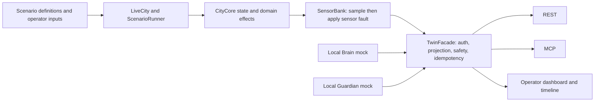

# City Brain Convergence — Twin Layer

The Twin Layer is the Phase 1 city's local simulation and interface boundary. It owns simulated city state, sensor readings, scenario inputs, actuator validation, and Twin-side event records. Brain and Guardian are represented by in-process mocks for the standalone demonstration; real partner services are not integrated or verified in this repository.

**Current status (8 November 2026):** the standalone Twin-plus-mocks demo has passed; the latest campaign passes all six individual scenarios, sequential execution, cross-scenario checks, and local process-restart checks. The overall campaign remains **BLOCKED** because real Brain/Guardian outage checks require absent partner services. SCN-03's updated supported-signal rejection behavior and evidence are recorded in [Status](docs/STATUS.md), [Test Book](TESTBOOK.md), and [Scenario Book](docs/SCENARIO_BOOK.md).


## What the Twin does

- Advances a deterministic, software city model across water, power, traffic, air, and responder domains.
- Separates physical model state from sensor-reported values. Faults such as stuck, dead, drift, dropout, delay, and false readings affect sensor output without directly changing CityCore state.
- Accepts role-authenticated reads and actuator/isolation requests through a shared façade exposed by REST and MCP.
- Records scenario lifecycle events and JSONL audit output, subject to documented in-memory and persistence limits.

The sensor-side harbour, drain, reservoir, coolant, and process models are illustrative and uncalibrated. Similar names or sensor links do not establish a physical connection to every CityCore actuator. See [sensor verification](docs/SENSOR_VERIFICATION.md) and [known limitations](docs/KNOWN_LIMITATIONS.md).

## Architecture



The mock calls use TwinFacade in-process. The Twin does not make outbound calls to real Brain or Guardian services and does not require a request-bound positive Guardian approval. The diagram therefore describes local boundaries, not a verified three-service deployment.

## Repository map

| Path | Purpose |
|---|---|
| `src/city_core/` | City state, validation, domain effects, lifecycle, and replay. |
| `src/city_live/` | Live runtime, sensor bank, sensor physics, scenarios, and operator commands. |
| `src/twin_interface/` | Shared façade, role checks, REST, and MCP adapters. |
| `src/city_dashboard/` | Operator dashboard, API bridge, and timeline UI. |
| `src/twin_observability/`, `src/twin_persistence/` | Event/audit handling and SQLite persistence. |
| `mocks/` | In-process Brain and Guardian demonstration clients. |
| `scenarios/` | Six scenario JSON definitions and shared launcher. |
| `tests/`, `live_tests/`, `dashboard_tests/` | Core/interface/security, live runtime, and dashboard tests. |
| `tools/` | Application launchers, validation runners, and evidence tools. |
| `config/`, `fixtures/`, `schemas/` | Device configuration, contracts, and fixtures. |
| `docs/`, `test-evidence/`, `logs/` | Technical guidance, dated campaign output, and runtime logs. |

`build/lib/` is a tracked build snapshot; production source is under `src/`. It was retained and is not an application entry point. The older README was preserved at [docs/archive/README_legacy_2026-11-07.md](docs/archive/README_legacy_2026-11-07.md); use this root README and the linked current docs for instructions.

## Install

Python 3.12 or newer is required. From the repository root:

```powershell
python -m venv .venv
.venv\Scripts\python.exe -m pip install --disable-pip-version-check -r requirements.lock
```

On macOS/Linux, activate `.venv` and use `python -m pip` with the same lock file. `requirements.lock` is the runtime dependency export used by the Docker image; `uv.lock` is the project lock.

## Local launch and configuration

For the local dashboard and MCP server sharing one `LiveCity` owner:

```powershell
.venv\Scripts\python.exe -X utf8 tools/run_twin.py --dev
```

Keep the terminal open, choose the one-launch operator passphrase, then open the dashboard URL printed by the launcher (default `http://127.0.0.1:8765`). MCP defaults to port `8000`. `--dev` enables built-in local-development role tokens only for this local demo; do not use it for deployment.

For the network-facing single-owner ASGI application, run `src/twin_app.py` after providing four distinct role tokens and an exact host allowlist. Generate real random secrets in a secret manager; do not commit them. Required settings and startup checks are documented in [PERSON_C_ASGI.md](docs/PERSON_C_ASGI.md). A safe placeholder template is [.env.example](.env.example); its `REPLACE_ME` values deliberately cannot authenticate.

Docker Compose requires a private environment file. Copy `.env.example` to `.env`, replace every placeholder with generated values, then run:

```powershell
$env:TWIN_ENV_FILE = ".env"
docker compose up --build
```

The example host allowlist is for local use only. See [Docker deployment instructions](docs/DOCKER.md) before exposing the service.

## Mock-backed demonstration

Run the bounded standalone proof with a fresh run ID:

```powershell
.venv\Scripts\python.exe -X utf8 tools/run_standalone.py --ticks 1150 --run-id jury-demo-20261107-a1
```

Expected local observations: the Guardian **mock** isolates `PRT-WLV-01` against `PRT-WLV-02` at the injected discrepancy; the Brain **mock** dispatches `PRT-PMP-02` after the simulated level crosses its threshold; the launcher prints `[PASS]` and writes `logs/standalone_jury-demo-20261107-a1.jsonl`. Choose a new run ID for each run to avoid reusing an output path.

This demonstrates the Twin with in-process mocks. It is not evidence of real partner service connectivity, browser timeline rendering, or a full physical sensor/actuator feedback loop. See the [demo guide](docs/DEMO_GUIDE.md).

## Scenarios and tests

Launch one existing scenario through the shared dashboard/MCP owner:

```powershell
.venv\Scripts\python.exe -X utf8 scenarios/run.py --scenario scn-03
```

The launcher prompts for the operator passphrase. Available IDs are `t5`, `scn-02`, `scn-03`, `scn-04`, `scn-05`, and `scn-06`. SCN-03 targets supported signal `DTN-TLT-01`, linked to frozen `DTN-TRF-01`; without a registered traffic backup the command is safely rejected. The focused SCN-03 test and 8 November campaign passed; real partner behavior remains unverified.

Run each project validation suite using the repository's Python 3.12 environment:

```powershell
$env:PYTHONPATH = "src"
.venv\Scripts\python.exe -X utf8 -m unittest discover -s tests/unit -t .
.venv\Scripts\python.exe -X utf8 -m unittest discover -s tests/integration -t .
.venv\Scripts\python.exe -X utf8 -m unittest discover -s tests/interface -t .
.venv\Scripts\python.exe -X utf8 -m unittest discover -s tests/security -t .
.venv\Scripts\python.exe -X utf8 tools/run_live_checks.py --evidence tmp/validation/live
.venv\Scripts\python.exe -X utf8 tools/run_dashboard_checks.py --evidence tmp/validation/dashboard
.venv\Scripts\python.exe -X utf8 tools/run_checks.py --evidence tmp/validation/core
.venv\Scripts\python.exe -X utf8 tools/run_scenario_campaign.py --evidence-root test-evidence
```

The campaign creates a new dated folder and returns nonzero when required external checks are blocked or fail. Do not interpret local role calls as partner-service responses. See [Testing](docs/TESTING.md) and [TESTBOOK.md](TESTBOOK.md) for current outcomes and limitations.

## Evidence and current limitations

- The campaign JSON and per-scenario Twin events, dashboard frames, and JSONL logs are under `test-evidence/`; standalone JSONL logs are under `logs/`.
- The latest dated campaign evidence, exact command results, and partner status are indexed in [docs/STATUS.md](docs/STATUS.md).
- Real Brain/Guardian integration is **NOT VERIFIED**; outbound adapters and partner endpoints are absent.
- Guardian enforcement is quarantine/veto-based; a positive request-bound Guardian authorization is not implemented.
- SCN-03 validates sensor fault reporting and safely rejects a command to linked signal `DTN-TLT-01` when `DTN-TRF-01` has no registered backup. The focused test and latest campaign passed. `IND-VLV-01` remains catalogued unsupported.
- Some sensor-side physics are illustrative and are not coupled to similarly named CityCore assets. Sensor-to-actuator feedback is verified only for specific documented relationships.
- `PRT-PMP-01` and `PRT-PMP-02` share CityCore target `P-03`; they are not independent redundant pumps.
- Compose configuration can be validated locally, but a live deployment requires real credentials, an allowed host, container runtime, and persistent storage configuration.
- The browser dashboard is a Twin operator view; a live three-layer partner timeline has not been verified.

## Documentation index

- [Current status and evidence index](docs/STATUS.md)
- [Demonstration guide](docs/DEMO_GUIDE.md)
- [Test commands and interpretation](docs/TESTING.md)
- [Known limitations](docs/KNOWN_LIMITATIONS.md)
- [Architecture overview](docs/ARCHITECTURE.md)
- [Partner interface card](docs/INTERFACE_CARD.md)
- [Partner connection guide](docs/PARTNER_TESTING.md)
- [Scenario book](docs/SCENARIO_BOOK.md) and [verification matrix](docs/SCENARIO_VERIFICATION_MATRIX.md)
- [Security model](docs/SECURITY.md)
