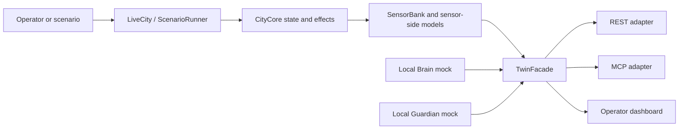

# Twin Layer architecture

## Runtime boundaries

The production implementation is under `src/`. `LiveCity` owns the active simulated state, `ScenarioRunner` applies declared scenario inputs/faults, and the `SensorBank` samples values before fault transforms produce reported readings. The `TwinFacade` is the shared role-authentication, projection, safety, and command boundary used by REST and MCP.

The mocks call the same façade in-process. There is no outbound real Brain/Guardian client in this repository.

## Main packages

- `city_core`: immutable state, domain balances, effect validation, replay, and lifecycle.
- `city_live`: runtime composition, sensors, faults, illustrative sensor physics, scenario orchestration, and operator commands.
- `twin_interface`: role tokens, permissions, public projections, TwinFacade, REST, and MCP.
- `city_dashboard`: local operator UI and its API bridge.
- `twin_observability`: timeline/event records and JSONL scenario logs.
- `twin_persistence`: SQLite-backed CityCore replay/effect receipt persistence used by the unified ASGI app.

## State and causality

CityCore state is separate from sensor-reported values. Sensor faults alter reported readings or availability; they do not themselves apply CityCore effects. Some sensor-side models are illustrative and not coupled to similarly named CityCore devices. Verified feedback is relationship-specific; see [sensor verification](SENSOR_VERIFICATION.md) and the [scenario matrix](SCENARIO_VERIFICATION_MATRIX.md).

Actuator calls are validated through TwinFacade and mapped to supported CityCore effects. A catalog entry with `supported: false` must reject rather than imply a physical capability. Device IDs that alias one target do not represent independent redundancy.

## Entry points

- Local dashboard and MCP share one owner: `python tools/run_twin.py --dev`.
- Network-facing REST/MCP ASGI process: `python src/twin_app.py` with production role tokens and host configuration.
- Local mocks proof: `python tools/run_standalone.py --ticks 1150 --run-id <fresh-id>`.
- Existing scenario: `python scenarios/run.py --scenario <scenario-id>`.

Setup, evidence, and limitations are linked from the root [README](../README.md).
