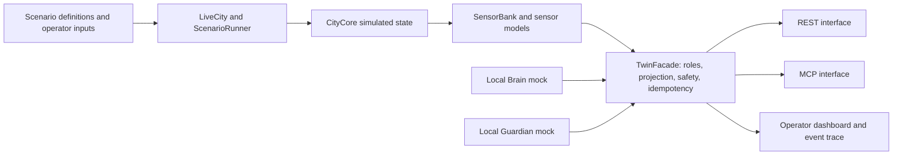

# Architecture

## Responsibility

The Twin owns the local city simulation, sensor readings, scenario inputs, command validation, and Twin event records. It is the safety and state boundary between callers and simulated CityCore effects.

The mocks run in-process for the standalone demonstration. This repository has no outbound Brain/Guardian clients, and the dashboard does not independently verify the process that supplied a role-authenticated request. Partner integration is **NOT VERIFIED**.

## Request and observation flow

1. A scenario or operator action supplies a declared input or fault.
2. `LiveCity` advances CityCore and the sensor path.
3. Sensor truth and reported values remain distinct; fault injection changes the reporting path.
4. `TwinFacade` applies role checks, validation, quarantine, idempotency, and CityCore effect checks.
5. Twin events and dashboard frames record local observations and outcomes.

A simulated command result is not a physical actuator acknowledgement. A pending marker means a response is awaited; it is not a Brain or Guardian decision.

## Main code areas

| Path | Responsibility |
| --- | --- |
| `src/city_core/` | Simulated city state and domain effects |
| `src/city_live/` | Runtime, sensors, scenarios, and operator lifecycle |
| `src/twin_interface/` | Shared facade, role checks, REST and MCP adapters |
| `src/city_dashboard/` | Local operator dashboard and frame projection |
| `mocks/` | In-process demo clients |
| `scenarios/` | Scenario definitions and launcher |
| `test-evidence/` | Dated campaign and validation evidence |

For current results, read [Status](STATUS.md) and [Testing](TESTING.md).
