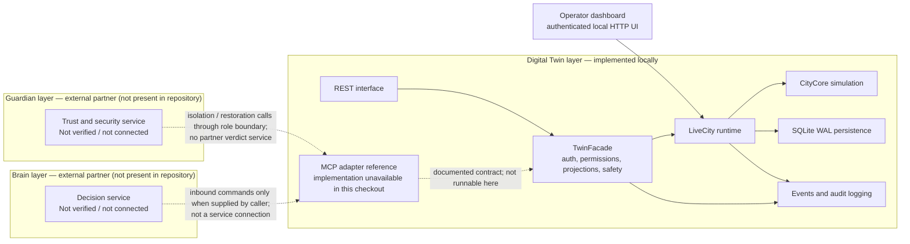
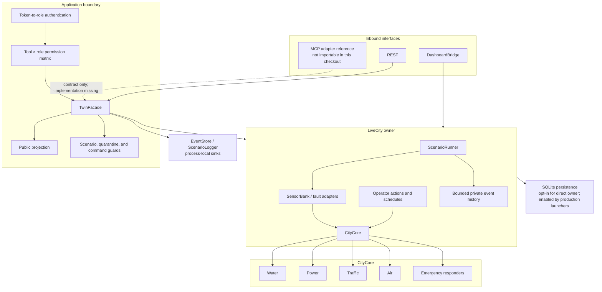
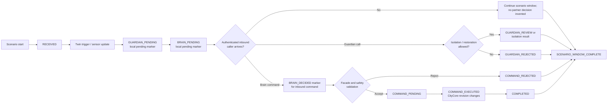
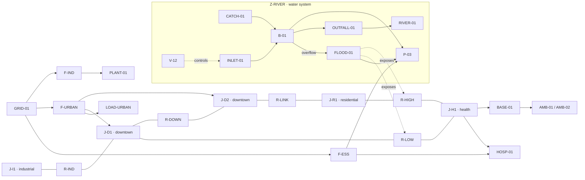
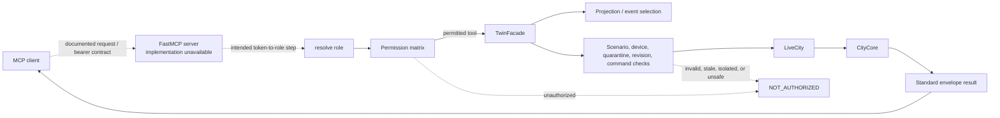
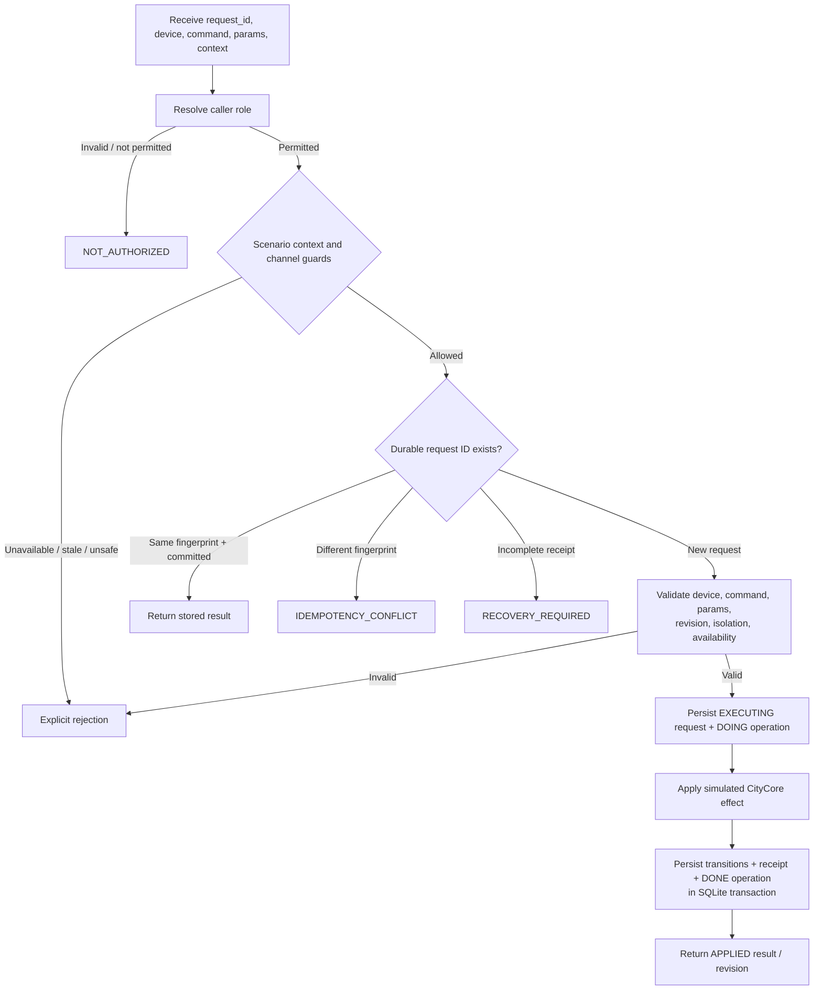
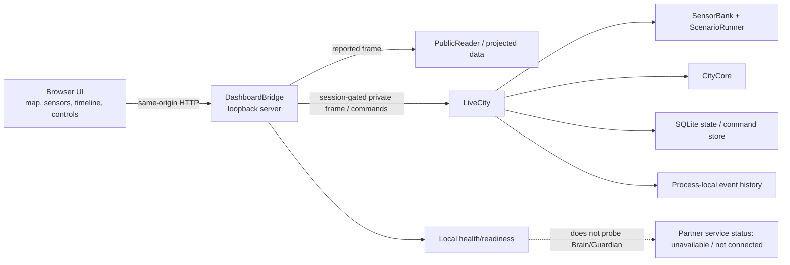

# IEEE TSYP14 City Brain Convergence Digital Twin
## Technical Architecture, Scenario Evaluation, and Resilience Report

**Document status:** Evidence-based implementation report  
**Evidence snapshot:** 2 November 2026  
**Audience:** IEEE TSYP14 jury, smart-city and Digital Twin specialists, architects, developers  
**Primary evidence:** [Final scenario campaign](../test-evidence/scenario-campaign-20261102T170547.703254Z-de4e30cd/FINAL_VERIFICATION.md), machine-readable [campaign results](../test-evidence/scenario-campaign-20261102T170547.703254Z-de4e30cd/campaign.json), and [browser validation](../test-evidence/scenario-campaign-20261102T170547.703254Z-de4e30cd/browser-validation.json).

> **Scope and evidence note.** This report describes the implementation visible in the source and the actual evidence bundle linked above. The Brain and Guardian partner services are not present in this repository. Calls exercised under their role credentials are local test calls through the Twin interface. The inter-layer failure scenario uses deterministic local failure injection, not a network outage. “Actuator execution” in this report means an effect on simulated CityCore state; it does not mean physical equipment was contacted.

## 1. Introduction

Cities must coordinate infrastructure while handling incomplete, delayed, erroneous, and potentially manipulated observations. Flood response, traffic routing, sensor-health management, and equipment isolation all depend on timely data and safe actuation. A digital representation can support that work by combining sensor ingestion, state estimation, policy enforcement, scenario testing, and operator visibility. It does not by itself establish that partner decision services or physical control systems are connected.

The IEEE TSYP14 City Brain Convergence project implements a local Digital Twin runtime for city infrastructure and a guarded interface through which authenticated clients can observe state, request simulated actuator changes, and quarantine or restore devices. It also provides scenario fixtures, a browser dashboard, event/audit evidence, and SQLite persistence for core replay and command idempotency.

The engineering problem addressed is to make the Twin’s state and command boundary understandable and testable while preserving safety under noisy inputs, duplicate requests, stale state, and process restart. The project objectives are:

1. Model city infrastructure state and domain interactions in the `city_core` package.
2. Provide a paced runtime, sensor adapters, event/scenario handling, and operator commands through `LiveCity`.
3. Provide a REST interface and shared `TwinFacade`; preserve the documented MCP interface contract while identifying the missing MCP server implementation in the current checkout.
4. Apply authentication, a role/tool allowlist, projected sensor readings, command validation, isolation, and idempotency.
5. Demonstrate six deterministic scenarios and test persistence, failure handling, dashboard display, and restart behavior.

The verified contribution is a local Twin prototype with scenario and resilience evidence. A live Brain service, a live Guardian service, production inter-layer networking, a physical actuator gateway, and measured deployment performance are outside the demonstrated scope.

## 2. Overall System Architecture

The project is organized conceptually around three collaborating layers—Twin, Brain, and Guardian—but only the Twin runtime and the partner-facing authorization boundaries are implemented in this repository. The Brain and Guardian in the diagrams below are therefore **external actors at defined interfaces**, not running local services.

### Figure 1. Three-layer architecture and actual repository boundary



### Table 1. Component responsibility

| Component | Responsibility in the implementation | Source |
|---|---|---|
| `city_core` / CityCore | Applies validated effects and produces revisioned city state and replay transitions. Domains include traffic, water, power, air, responders, access, catalog, and clock. | [`src/city_core/`](../src/city_core), [`core.py`](../src/city_core/core.py), [`effects.py`](../src/city_core/effects.py) |
| `LiveCity` | Owns a CityCore instance, simulation thread/clock, sensor and traffic adapters, scheduled actions, scenario runner, event history, operator request processing, and optional persistence. | [`runtime.py`](../src/city_live/runtime.py), [`operator.py`](../src/city_live/operator.py) |
| `SensorBank` | Holds the local sensor registry, generated/delivered readings, fault injection, and sensor-to-device relations. | [`sensors.py`](../src/city_live/sensors.py), [`faults.py`](../src/city_live/faults.py), [`registry.py`](../src/city_live/registry.py) |
| `ScenarioRunner` | Loads scenario JSON, seeds scenario-local state, processes tick-based triggers, and emits lifecycle/correlation events. | [`b_scenarios.py`](../src/city_live/b_scenarios.py), [`scenarios/`](../scenarios) |
| `TwinFacade` | Enforces caller role permissions at the application boundary; projects observations; applies scenario and isolation gates; delegates commands; records events. | [`facade.py`](../src/twin_interface/facade.py), [`permissions.py`](../src/twin_interface/permissions.py) |
| MCP adapter | Launchers reference `twin_interface.mcp_server.server`, but that implementation module is absent in this checkout; its advertised tools and transport cannot be verified here. | [`mcp_server/`](../src/twin_interface/mcp_server), [`run_twin.py`](../tools/run_twin.py), [`serve_mcp.py`](../tools/serve_mcp.py) |
| REST router | Provides HTTP health, observations, events/timeline, commands, isolation, and restoration routes using the same facade. | [`router.py`](../src/twin_interface/rest/router.py) |
| Dashboard bridge/UI | Serves the local operator and reported views; authenticated operator routes expose a frame, scenario start, and bounded operator commands. | [`server.py`](../src/city_dashboard/server.py), [`web/`](../src/city_dashboard/web) |
| Twin persistence | Stores CityCore replay transitions, durable command receipts/operations, recovery metadata, and quarantines in SQLite. | [`store.py`](../src/twin_persistence/store.py), [`migrations.py`](../src/twin_persistence/migrations.py) |
| Observability | Provides event storage, sequence/timeline handling, and JSONL scenario audit logging. Several of these stores are process-local. | [`src/twin_observability/`](../src/twin_observability) |
| Brain partner | Expected to analyze observations and send commands through the interface; no service, client, or running response was verified. | Campaign boundary in [`campaign.json`](../test-evidence/scenario-campaign-20261102T170547.703254Z-de4e30cd/campaign.json) |
| Guardian partner | Expected to review trust/safety and call isolation/restoration; no service or partner verdict was verified. | Same campaign evidence; [`b_scenarios.py`](../src/city_live/b_scenarios.py) marks some events as awaiting real inbound calls. |

### Figure 2. Twin internal architecture



CityCore is authoritative for modeled physical state. LiveCity coordinates time and adapters around it. The dashboard renders frames assembled from this runtime and does not call the Brain or Guardian. A dashboard’s `COMPLETED` operator command is distinct from a partner-issued Brain command.

## 3. Digital Twin Layer

### 3.1 CityCore, LiveCity, and state synchronization

CityCore applies domain effects against a revisioned state and exposes lifecycle/replay operations. The LiveCity runtime wraps it with a synchronized simulation clock and a serialized owner boundary. At each simulation tick, LiveCity advances core state, updates the modeled city and sensor state, processes scheduled actions, and lets the active scenario runner evaluate triggers. The wall-paced background loop is started by `LiveCity.start()`; `pause()`, `stop()`, `step()`, `reset()`, and `close()` manage the runtime lifecycle.

The runtime includes water, power, traffic, air-quality, and emergency-response model state. This is a deterministic/local simulation model, not a real-time digital connection to municipal equipment. SensorBank readings are generated or controlled by local adapters; scenario fixtures may seed values and faults. `reported_value` is the projected measurement supplied to ordinary clients; internal sensor records can retain actual/ground-truth and fault attributes.

### 3.2 Event and data management

Private runtime events carry sequence, run, tick, timestamp, type, and entity identifiers. Scenario lifecycle envelopes additionally carry `event_id`, `correlation_id`, `scenario_id`, optional `device_id`, source, event type, and payload. The current scenario’s lifecycle uses the correlation ID returned by `ScenarioRunner.start()`. Scenario event order is checked in the campaign; event-store and runtime histories are bounded/process-local and are reset at owner lifecycle boundaries as implemented.

The facade wraps successful and unsuccessful calls in the common envelope:

```json
{
  "ok": true,
  "run_id": "run identifier",
  "data": {},
  "error": null,
  "timestamp": "UTC timestamp"
}
```

The example shows the successful response shape; errors carry a code, message, and optional details. The envelope is implemented in [`envelope.py`](../src/twin_interface/envelope.py).

### Figure 3. Event lifecycle and caller/partner boundary

```mermaid
sequenceDiagram
    autonumber
    participant S as Scenario trigger / SensorBank
    participant L as LiveCity + ScenarioRunner
    participant F as TwinFacade
    participant G as Guardian caller
    participant B as Brain caller
    participant C as CityCore
    participant A as Event/audit sinks
    S->>L: Trigger, sample or controlled fixture
    L->>A: RECEIVED / TWIN_UPDATED / pending markers
    Note over A,G: Pending means awaiting an inbound caller; it is not a partner response.
    G-->>F: Optional authenticated isolate/restore call
    F->>F: Role and safety checks
    F->>L: Apply allowed quarantine change
    B-->>F: Optional authenticated actuator request
    F->>F: Permission, scenario, quarantine, validation, revision checks
    F->>C: Apply simulated effect when accepted
    C-->>F: Receipt and resulting revision
    F->>A: COMMAND_EXECUTED / COMPLETED or rejection
    F-->>B: Standard response envelope
```

No automatic outbound request to Brain or Guardian is demonstrated. For example, a `BRAIN_PENDING` or `GUARDIAN_PENDING` marker is emitted by the Twin and describes the local event lifecycle. It is not evidence that a remote service received or answered a request. In test campaigns, role credentials are configured locally and calls are made directly to TwinFacade.

### 3.3 Scenario lifecycle and orchestration

`ScenarioRunner` reads six JSON scenario definitions and executes their triggers against the local Twin. It produces event/correlation traceability and can inject faults, seed domain state, quarantine an actuator trigger, and—for SCN-06—toggle local partner-channel availability flags. The runner is shared; it does not instantiate independent physics engines or a second set of interfaces.

### Figure 4. Scenario execution lifecycle



Event names are not a guarantee of partner completion. Some source fields describe an inbound role call from the test harness; the evidence labels the call path as local. A scenario can complete its configured time window without a Brain decision or Guardian verdict.

### 3.4 City plan, zones, and infrastructure topology

The modeled city is a compact, typed infrastructure graph rather than a GIS-grade map. The CityCore catalog defines `CITY-01`, five zones, roads and junctions, a hospital and responder base, an industrial plant, an urban load, a river/catchment/basin/flood/outfall water chain, a pump and valve, and an electricity source with three feeders. The accepted catalog contains 35 entities, 36 directed relationships, and 21 device bindings. The catalog version is explicitly `pa-catalog-0.1-draft`; it is a simulation topology, not a surveyed municipal asset inventory.

| Zone | Modeled role and representative entities | Connected modeled systems |
|---|---|---|
| `Z-DOWNTOWN` | Junctions `J-D1`, `J-D2`; roads `R-LOW`, `R-DOWN`; urban load `LOAD-URBAN` | Traffic, signals, flood exposure on `R-LOW`, urban feeder `F-URBAN` |
| `Z-RESIDENTIAL` | Junction `J-R1`; roads `R-HIGH`, `R-LINK` | Traffic, residential sensor namespace, flood exposure on `R-HIGH` |
| `Z-INDUSTRIAL` | Junction `J-I1`; road `R-IND`; plant `PLANT-01` | Traffic access, industrial feeder `F-IND`, modeled PM2.5 source |
| `Z-RIVER` | `RIVER-01`, `CATCH-01`, `INLET-01`, basin `B-01`, surface store `FLOOD-01`, outfall `OUTFALL-01`, valve `V-12`, pump `P-03` | Rainfall/runoff, basin level, overflow exposure, drainage and pump discharge |
| `Z-HEALTH` | Hospital `HOSP-01`, base `BASE-01`, `AMB-01`, `AMB-02`, `POL-01` | Emergency response and essential-services feeder `F-ESS` |

### Figure 11. Conceptual CityCore topology (not to scale)



The figure expresses only cataloged relationships and selected connectivity; it is not a map, a complete network drawing, or proof of field locations.

Road and service relationships are explicit: roads connect junctions; emergency assets have access/base relationships; runoff feeds the basin; the basin can spill into a surface store that exposes selected roads; drainage and the pump discharge toward the river; and the grid supplies three feeders connected to modeled loads. These links let a change in one domain influence another instead of merely changing an isolated dashboard label.

**Important representation boundary.** The topology catalog and the runtime device catalog are related, but they are not one globally reconciled physical-asset register. The runtime catalog maps prefixes `PRT`, `IND`, `DTN`, `RES`, and `HSP` to the five CityCore zones. For example, `PRT` maps to `Z-RIVER`. Device identifiers in the two catalogs can differ. The report therefore describes modeled bindings and explicit mappings, not verified field deployment or exact geospatial coordinates. The 3D model is illustrative and has not been georeferenced to this topology.

**Source:** [`catalog.json`](../src/city_core/data/catalog.json), [`catalog.py`](../src/city_core/catalog.py), and the runtime mapping in [`device_catalog.json`](../src/city_live/data/device_catalog.json).

### 3.5 Sensors and simulated actuators

The generated device-catalog file contains 16 sensor definitions across the river/harbor (`PRT`), industrial (`IND`), downtown (`DTN`), and residential (`RES`) namespaces. The actual `SensorBank` currently loads the separate `sensors.json` proposal registry and appends 13 legacy `S-*` records from the CityCore catalog, so its effective registry contains 29 sensor identities. These are modeled/local adapters, not deployed field sensors. Typical units are water level in centimetres, flow in litres per second, pressure in bar, temperature in degrees Celsius, and traffic in vehicles per minute. Sampling intervals are device-specific (5, 10, or 60 simulation seconds).

The table below summarizes the generated device catalog, not the effective SensorBank binding state. For current SensorBank sources, consult [`sensors.json`](../src/city_live/data/sensors.json) and the legacy adapter construction in [`registry.py`](../src/city_live/registry.py).

| Runtime zone | Sensor inventory | Model binding and noteworthy behavior |
|---|---|---|
| `PRT` → `Z-RIVER` | `PRT-WLV-01`, `PRT-WLV-02`, `PRT-FLW-01`, `PRT-PRS-01` | Harbor level, pump outlet flow, and header pressure; the two level definitions name each other as backups. |
| `IND` → `Z-INDUSTRIAL` | `IND-TMP-01`, `IND-TMP-02`, `IND-PRS-01`, `IND-FLW-01` | Process temperature (including a declared alternate), coolant pressure and flow. |
| `DTN` → `Z-DOWNTOWN` | `DTN-TRF-01`, `DTN-TRF-02`, `DTN-WLV-01`, `DTN-TMP-01` | Traffic derived from departures on selected roads, storm-drain level, ambient temperature. |
| `RES` → `Z-RESIDENTIAL` | `RES-WLV-01`, `RES-PRS-01`, `RES-FLW-01`, `RES-TRF-01` | Reservoir level, network pressure and flow, traffic derived from selected-road departures. |

`SensorBank` samples the current CityCore snapshot into bounded history buffers. It maintains actual/source and reported values internally, applies configured faults, and produces separate public and private reading forms. The ordinary report projection is not a ground-truth channel. Fault injection and scenario-seeded measurements support repeatable tests of false readings, frozen data, dropout/death, delay, or noise; they do not represent a real sensor network.

**Current catalog inconsistency—scenario blocker.** The 16-row `sensors.json` proposal registry has `source: null` for `PRT-WLV-01`, `IND-TMP-01`, `IND-TMP-02`, and most other proposed point sensors; only the three proposed traffic-count rows are source-bound there. `SensorBank.set_scenario_input()` and fault injection reject unbound rows. A focused execution against the current checkout on 6 November 2026 reproduced this: starting `t5` and `scn-03` fails with `SENSOR_UNBOUND`; starting `scn-02` succeeds, but its first tick fails with `SENSOR_UNBOUND`. This conflicts with the older 2 November campaign bundle, which records those scenarios as passing. Treat that bundle as historical evidence, not proof that those scenarios are currently reproducible, until the source registry/catalog mapping is reconciled and the current campaign is rerun.

The runtime catalog has 18 actuator entries, of which 17 are marked supported by the catalog. Entries include traffic signal controls, valves, pumps, feeder switches, and emergency responders. Some identifiers are compatibility aliases, not separate actuators. In particular, `PRT-PMP-01` and `PRT-PMP-02` both resolve to CityCore target `P-03`; they do not establish an independent redundant pump. `RES-TLT-01` is marked unsupported. The CityCore topology itself declares eight actuator/control bindings. These counts describe software catalog records, not commissioned equipment.

| Control family | Example identifiers | CityCore effect represented |
|---|---|---|
| Signals | `DTN-TLT-01` / `J-D1`, `DTN-TLT-02` / `J-D2` | Change a junction signal mode and therefore the modeled road capacity. |
| Water controls | `DTN-VLV-01`, `IND-VLV-01`, `RES-VLV-01`, `V-12`; pump entries `P-03`, `PRT-PMP-01`, `PRT-PMP-02` | Change simulated valve opening or pump enable/speed at the mapped CityCore target. |
| Feeders | `F-ESS`, `F-URBAN`, `F-IND` | Change modeled feeder availability/position and dependent asset power state. |
| Responders | `AMB-01`, `AMB-02`, `POL-01` | Reserve or release a simulated responder on a validated road route. |

Accepted commands mutate only the simulated CityCore state. They are subject to caller permissions, command/schema validation, availability and quarantine checks, scenario guards, and revision checks before the effect is applied. A successful response is not a physical actuation receipt.

**Sources:** [`device_catalog.json`](../src/city_live/data/device_catalog.json), [`sensors.py`](../src/city_live/sensors.py), [`registry.py`](../src/city_live/registry.py), [`effects.py`](../src/city_core/effects.py), and [`device_catalog.py`](../src/city_live/device_catalog.py).

### 3.6 Simulation model and state evolution

CityCore uses a deterministic fixed step of 1,000 ms. LiveCity controls wall-clock pacing (0.5× to 10×) without changing the model step or skipping catch-up ticks. At each step the owner advances the CityCore domains, captures sensor-source state and road departures, publishes scheduled samples, and processes scenario triggers. The state is revisioned; effects carry an expected revision, and the core keeps transition records and state digests for replay/validation.

The model contains coupled, bounded engineering rules:

* **Water:** rainfall contributes catchment runoff; a valve controls inlet flow; gravity and pump capacities limit discharge; excess is retained in basin/surface storage. Derived surface depth can close configured flood-exposed roads at the model threshold.
* **Traffic:** roads carry queues and arrivals; usable capacity depends on obstruction, flood closure, and the controlling signal mode. A priority signal has a configured capacity multiplier; stop or unpowered signals provide no modeled capacity.
* **Power:** a source and three feeder states determine whether the hospital, pump, urban loads/signals, and plant are energized. Requested and delivered modeled demand are calculated from fixed profile values.
* **Air:** each zone tracks PM2.5 concentration using a declared industrial source term and relaxation toward a background concentration.
* **Emergency response:** ambulance and police units reserve validated routes over the road graph and move deterministically by tick; unusable roads can block progress.

For scale, the packaged profile uses a 6,000 m³ basin capacity, a 20,000 m² catchment, a 1,000 m² surface store, maximum inlet/gravity/pump flows of 0.6/0.2/1.2 m³/s, and a 0.2 m flood-close threshold for the configured flood-exposed roads. Base road capacity is 0.5 vehicles/s; a priority signal uses a 1.5 multiplier. Feeder ratings are 100 kW (`F-ESS`), 120 kW (`F-URBAN`), and 150 kW (`F-IND`). These are explicit local model parameters, not site measurements or validated engineering design values.

These are deliberately bounded local models, not calibrated engineering-grade hydrology, load-flow, traffic assignment, dispersion, or dispatch models. They provide a transparent causal sandbox for scenario response and interface/safety evaluation. The packaged initial condition and coefficients are versioned in [`initial_config.json`](../src/city_core/data/initial_config.json); domain transitions are implemented in [`water.py`](../src/city_core/water.py), [`traffic.py`](../src/city_core/traffic.py), [`power.py`](../src/city_core/power.py), [`air.py`](../src/city_core/air.py), and [`responders.py`](../src/city_core/responders.py).

### 3.7 How scenarios are played and evaluated

Scenario JSON files are translated by one `ScenarioRunner` into actions against the shared `LiveCity` owner and its CityCore. They do not start a parallel physics model. The runner seeds scenario inputs, schedules trigger actions against simulation ticks, applies configured sensor faults or local availability changes, and emits scenario events under one generated correlation ID. Client commands still pass through the same TwinFacade checks as other requests. However, the catalog inconsistency documented in Section 3.5 currently prevents some sensor-dependent scenarios from completing; scenario definitions and an older passing campaign must not be presented as a fresh pass for the current checkout.

For an interactive local run, the repository launcher accepts a scenario ID:

```powershell
python tools\run_twin.py --scenario scn-02
```

The launcher prompts for a one-launch operator passphrase, starts the Twin, dashboard, and MCP endpoint against the same `LiveCity` owner, then starts the named scenario before wall-paced simulation begins. The operator can inspect the frame and event history, submit allowed commands, and stop the process with `quit` or Ctrl+C. For campaign evidence, use the project’s scenario-campaign runner rather than relying on a visual impression alone. Use a fresh `TWIN_STATE_DB_PATH` and unique run ID when an isolated persistent run is required; otherwise the configured SQLite database may restore an existing active run.

| Stage | What happens | What should be recorded |
|---|---|---|
| Start | Load a named JSON scenario and create its correlation ID. | Scenario ID, run ID, starting tick/revision. Confirm the current registry binds every triggered sensor. |
| Trigger | On the configured tick, seed a value, inject/clear a fault, or toggle a local channel flag. | Trigger source, target, tick, and whether it is a fixture. |
| Observe | SensorBank samples from the model and the Twin emits state/events. | Actual versus reported values where authorized; public projections should not expose private ground truth. |
| Decide/command | A test caller or operator may submit a command through the interface; no partner service is implied. | Caller role, request/correlation IDs, acceptance or rejection reason. |
| Apply/check | On acceptance, CityCore records a simulated effect and advances revision; rejected effects should not mutate state. | Before/after state and revision, command result, persistence record where applicable. |
| Close/evaluate | Scenario window completes; campaign checks the trace, invariants, and outcome. | Final state, event order, assertions, logs, and explicit limitations. |

SCN-06 is especially useful for demonstrating disciplined failure handling: it deterministically flips local Brain/Guardian availability flags, expects calls to fail closed, keeps quarantine in force, and checks a fresh post-recovery command. It does **not** drop a network connection or restart an external partner. The scenario and evidence must be presented as a local interface failure-injection test.

### 3.8 Technology stack and engineering differentiators

| Layer | Technologies evidenced in the repository | Role |
|---|---|---|
| Twin and simulation | Python 3.12+; immutable/domain-oriented Python modules; Python standard library synchronization and HTTP server components | CityCore state transitions, LiveCity owner, sensors, scenario scheduler and local dashboard bridge. |
| Persistence | SQLite via Python `sqlite3`; WAL mode and migrations in `twin_persistence` | Durable replay/state transitions, idempotency records, operation records, and recovery metadata. |
| Interfaces | Python REST router; `TwinFacade`; JSON request/response envelopes; MCP launcher references | REST/facade code is present. The MCP launchers import a server module absent from this checkout, so no runnable MCP tool surface is claimed. |
| Dashboard | React 19.3.1, Three.js 0.187.0, Vite 8.3.6, Lucide React 1.69.0; Node.js 20.19+ or 22.12+ | Workshop-style primary view; data comes from the existing public reported projection or authenticated private operator frame, not a second demo API. |
| Verification | Pytest-based tests and repository campaign/evidence scripts; JSON scenario fixtures | Unit, integration, idempotency, restart, and scenario checks. |

The report’s strongest differentiators are engineering properties demonstrated by the implementation—not claims of autonomous city operation:

1. **A causal city sandbox, not just a 3D display.** Topology and domain state connect flood depth, road accessibility, signal capacity, feeder power, pump operation, air quality, and responder movement. Accepted simulated commands can be checked against resulting revisions and state.
2. **One local Twin owner backs the implemented REST and dashboard surfaces.** The REST router uses `TwinFacade`; the dashboard bridge reads from and controls the same `LiveCity` owner through its existing routes. This avoids separate simulation backends, while retaining the appropriate authorization and projection boundary for each implemented interface. The referenced MCP server is unavailable in this checkout and is not included in this claim.
3. **Sensor integrity is visible and privacy-aware.** The runtime can model actual/source and reported values separately, inject deterministic faults, and expose only the permitted projection to ordinary readers. A suspicious reading can be evaluated without presenting private ground truth as public data.
4. **Failure behavior is part of the scenario design.** The campaign includes bad/frozen/dead data, quarantine, competing events, changed revisions, duplicate requests, and controlled communication unavailability—not only a successful command demonstration.
5. **Restart safety has a durable design and executable evidence.** SQLite-backed request records and replayed CityCore state support returning an already committed result after restart instead of repeating a simulated effect. Cite the process-restart evidence in Section 9; do not generalize this to external physical actuators.
6. **The evidence boundary is explicit.** Pending markers are not partner replies, model markers are not surveyed coordinates, and simulated actuator states are not field actuation. This candor makes the demonstration auditable and gives a credible roadmap to integration.

> **Jury presentation tip.** Show one end-to-end causal chain: inject the documented water event, identify the resulting sensor sample and its reported status, submit a command with an explicit request/revision, show the safety decision, then compare CityCore state and revision before and after. Follow it with the same request replay (no second mutation) and a quarantined or stale-revision rejection. Label every test caller and local fixture, and state that Brain/Guardian partner services and physical equipment were not contacted.

## 4. Brain Layer

The intended Brain responsibility is to consume projected Twin observations and city state, reason about operational objectives, and propose infrastructure commands through the existing interface. The Twin supports a `brain` role for read tools and actuator command submission.

**Implementation status:** No Brain service, model, policy engine, network client, or live Brain decision loop was found or exercised in this repository. In scenario tests, code supplies a command via the Brain-role token to `TwinFacade`; the input is a controlled test caller, not an actual Brain service response. Lifecycle events labelled `BRAIN_DECIDED` are produced when an inbound command is handled. They must not be interpreted as proof that an external Brain computed the command.

The dashboard footer also identifies the UI as a local prototype without Brain policy decisions. This aligns with browser validation and the interface behavior in [`controls.js`](../src/city_dashboard/web/controls.js).

## 5. Guardian Layer

The intended Guardian responsibility is to assess data trust, recommend or perform device isolation, preserve security restrictions, and restore devices only after appropriate review. The Twin provides a `guardian` role for the isolation and restoration interface. It also enforces quarantines inside the Twin independent of any external Guardian runtime.

**Implemented locally:** role checks for `isolate_device` and `restore_device`, device-isolation state, reading availability overrides for isolated devices, command rejection for isolated devices, and scenario safety guards. SCN-04 and tests invoke local facade isolation calls under Guardian credentials.

**Not implemented/verified:** an external Guardian service, a remote trust verdict, request-bound positive authorization, and a live service-to-service protocol. Scenario “pending” markers explicitly state that a real Guardian call is awaited and that positive approval is unsupported. In SCN-06, a Guardian role call is rejected during the controlled outage and quarantine remains effective; this validates local fail-closed behavior, not an actual remote failure.

## 6. MCP Communication Architecture

The repository contains an MCP package directory and launchers that import `twin_interface.mcp_server.server`, but the referenced `server.py` implementation is absent from this checkout. A direct import check on 6 November 2026 failed with `ModuleNotFoundError`. Consequently, this report cannot verify or claim a runnable FastMCP server, registered MCP tools, MCP authentication behavior, or a functioning MCP transport. The following tool list and sequence diagram preserve the previously documented interface contract only; they are **not verified as available in the current checkout**. The REST router and local dashboard routes are separate implementation surfaces.

### Table 2. Previously documented MCP tool contract (current availability not verified)

| MCP tool | Inputs (excluding request context) | Result | Access status |
|---|---|---|---|
| `get_service_health` | none | Liveness and readiness reports | Unauthenticated service-health call |
| `get_sensor_readings` | `zone_id?`, `sensor_id?`, `sensor_type?` | Envelope containing current/latest projected sensor readings | Brain, Guardian, Operator, Evaluator |
| `get_city_state` | `zone_id?` | Envelope containing city/zone state and active alerts | Brain, Guardian, Operator, Evaluator |
| `get_events_since` | `seq=0` | Envelope with sequence cursor and new events | Brain, Guardian, Operator, Evaluator |
| `send_actuator_command` | `device_id`, `command`, `params`, `request_id`, `context?` | Simulated effect receipt or error envelope | Brain, Operator |
| `isolate_device` | `device_id`, `reason=""` | Isolation result or error envelope | Guardian, Operator |
| `restore_device` | `device_id` | Restoration result or error envelope | Guardian, Operator |

Because the MCP server implementation is missing, decorator discovery cannot be performed in this checkout and the table above must not be used as evidence that these tools are currently registered. The permission matrix is source code for facade-level role checks; it does not prove a running MCP transport or its methods.

### Table 3. REST and local dashboard interfaces

| Interface | Method and path | Function | Auth/notes |
|---|---|---|---|
| REST | `GET /health/live` | REST-process liveness | No authentication; does not probe partners |
| REST | `GET /health/ready`, `GET /health` | Local REST/facade readiness | No authentication; not whole-deployment health |
| REST | `GET /api/v1/sensors` | Projected readings, optional zone/sensor/type filters | Bearer authentication |
| REST | `GET /api/v1/state` | City state, optional zone filter | Bearer authentication |
| REST | `GET /api/v1/events?seq=N` | Cursor-based event query | Bearer authentication |
| REST | `GET /api/v1/timeline?seq=N` | Timeline view | Bearer authentication |
| REST | `POST /api/v1/commands` | Simulated actuator command | Bearer authentication; request ID required |
| REST | `POST /api/v1/isolate` | Quarantine a device | Bearer authentication; permission checked by facade |
| REST | `POST /api/v1/restore` | Restore a quarantined device | Bearer authentication; permission checked by facade |
| Dashboard | `GET /api/report/frame` | Reported/public view | No operator session; restricted projection |
| Dashboard | `POST /api/session`, `POST /api/logout` | Create/revoke local operator session | Launch passphrase; HttpOnly, SameSite=Strict cookie |
| Dashboard | `GET /api/operator/frame` | Private local operator frame | Authenticated local session |
| Dashboard | `POST /api/operator/scenario` | Start an existing scenario | Authenticated local session |
| Dashboard | `POST /api/operator/command` | Bounded local operator action | Authenticated local session |

The REST routes and schemas are defined in [`router.py`](../src/twin_interface/rest/router.py); dashboard routes are defined in [`city_dashboard/server.py`](../src/city_dashboard/server.py). Health endpoints report the answering process and required local runtime components, not external service availability.

### Figure 5. MCP communication and security boundary

*Documented contract only; the FastMCP server node is not importable from this checkout.*



### Table 4. Error handling examples

| Error | Meaning in the interface | Evidence/source |
|---|---|---|
| `NOT_AUTHORIZED` | Caller has no valid role or the role cannot invoke the tool | [`permissions.py`](../src/twin_interface/permissions.py), facade checks |
| `GUARDIAN_RESTRICTED` | Target is isolated; command must not be executed | [`facade.py`](../src/twin_interface/facade.py), `runtime.py` |
| `INVALID_STATE` | Scenario-level fail-closed block or state precondition is not met | SCN-01 and SCN-06 evidence |
| `STATE_CONFLICT` | Expected revision is stale; caller must refresh/revalidate | SCN-06 evidence, [`operator.py`](../src/city_live/operator.py) |
| `IDEMPOTENCY_CONFLICT` | Same request ID reused with a different fingerprint | [`store.py`](../src/twin_persistence/store.py), durable tests |
| `RECOVERY_REQUIRED` | A request has an uncertain/incomplete durable execution; it is not automatically replayed | persistence recovery tests |
| `PERSISTENCE_FAILURE` | Durable write did not establish a successful command result | [`runtime.py`](../src/city_live/runtime.py), persistence tests |

### Figure 6. Brain–Guardian–Twin interaction sequence (interface contract, not live service integration)

```mermaid
sequenceDiagram
    autonumber
    participant S as Sensor / Twin
    participant G as Guardian-role caller
    participant B as Brain-role caller
    participant F as TwinFacade
    participant C as CityCore
    S->>F: Projected observation / event
    F-->>G: Observable Twin state (poll/read interface)
    Note over G: External Guardian service is not present or verified.
    G->>F: isolate_device(device_id, reason)
    F->>F: Authenticate and authorize role; isolate locally
    F-->>G: ISOLATED result or error envelope
    F-->>B: Observable Twin state (poll/read interface)
    Note over B: External Brain service is not present or verified.
    B->>F: send_actuator_command(request_id, device, command)
    F->>F: Authenticate; permissions; scenario/quarantine/validation/revision
    alt valid, available and not isolated
      F->>C: Apply simulated CityCore effect
      C-->>F: committed receipt / revision
      F-->>B: APPLIED envelope
    else rejected
      F-->>B: explicit rejection envelope
    end
```

## 7. Scenario Campaign

Scenario definitions are stored in [`scenarios/scn_*.json`](../scenarios); orchestration is implemented in [`b_scenarios.py`](../src/city_live/b_scenarios.py). The latest individual and sequential execution evidence is in the campaign bundle. Here, PASS means the stated local scenario checks passed—not that external partner services participated.

**Evidence recency warning:** the `PASS` outcomes below are those recorded in the 2 November 2026 campaign bundle. The focused current-source check on 6 November found `SENSOR_UNBOUND` failures for T5/SCN-01, SCN-02, and SCN-03 as described in Section 3.5. Those historical PASS labels do not establish that these three scenarios run successfully in the current checkout; update them only after the registry/catalog mismatch is fixed and the campaign is rerun.

### SCN-01 — Fake flood at the port

- **Objective and motivation:** Demonstrate resistance to a suspicious flood-level reading that could trigger an unsafe pump command.
- **Initial conditions and trigger:** Scenario data seeds the Port water-level fixture; at tick 5, `PRT-WLV-01` receives a false fixed reading of 180.0. The fault is scheduled to clear after the scenario window.
- **Expected behavior:** Trace the suspicious reading, retain Guardian safety restrictions, and reject unsafe actuator dispatch.
- **Observed behavior:** A Twin update and pending Brain/Guardian markers were emitted. The controlled Brain-role command was rejected with `INVALID_STATE` while the Guardian veto check was pending. CityCore revision was 70 before and after; pump stayed disabled at 0.0.
- **Verification/result:** **PASS** for local detection/trace and fail-closed rejection. No external Brain decision or Guardian verdict was received.
- **Evidence:** [SCN-01 event trace](../test-evidence/scenario-campaign-20261102T170547.703254Z-de4e30cd/individual/individual-scn-01-city-events.json), [campaign record](../test-evidence/scenario-campaign-20261102T170547.703254Z-de4e30cd/campaign.json).
- **Limitation:** Fixture and fault are local simulation inputs; service-side trust scoring is not available.

### SCN-02 — Harbor basin surge and emergency dispatch

- **Objective and motivation:** Exercise a modeled flood surge and confirm accepted commands change Twin state.
- **Initial conditions and trigger:** Scenario fixture identifies `PRT-WLV-01`, pump `PRT-PMP-01`, and a seeded rise from 40 to 110 cm at tick 1.
- **Expected behavior:** Emit a Twin observation, apply safety checks, then mutate simulated water/pump state for an allowed command.
- **Observed behavior:** Revision moved 8→9 and pump changed from disabled/0.0 to enabled/0.30. The same request was repeated and returned the same outcome without a second revision.
- **Verification/result:** **PASS** for seeded-event handling, local interface execution, state mutation, and duplicate behavior.
- **Evidence:** [SCN-02 event trace](../test-evidence/scenario-campaign-20261102T170547.703254Z-de4e30cd/individual/individual-scn-02-city-events.json), campaign record.
- **Limitation:** The scenario title’s “real” describes the scenario narrative; the campaign used explicitly seeded Twin data and a local facade caller. Neither Brain/Guardian services nor physical infrastructure were involved.

### SCN-03 — Sensor death and frozen telemetry

- **Objective and motivation:** Distinguish stale/frozen or unavailable data from a genuine emergency and use a backup only if a validated relationship exists.
- **Initial conditions and trigger:** At tick 2, the traffic sensor `DTN-TRF-01` receives a `STUCK` fault and industrial temperature sensor `IND-TMP-01` receives `DEAD`. `IND-TMP-02` is identified as a backup fixture.
- **Expected behavior:** Reject unsupported/invalid evidence and accept a linked backup reading only when it is present and validated.
- **Observed behavior:** One request using invalid/no backup was rejected with `INVALID_STATE`; the request tied to `IND-TMP-02` was accepted. Valve opening changed from about 0.333 to 0.25, revision 10→11.
- **Verification/result:** **PASS** for fault representation, rejection, validated local backup behavior, and CityCore effect.
- **Evidence:** [SCN-03 event trace](../test-evidence/scenario-campaign-20261102T170547.703254Z-de4e30cd/individual/individual-scn-03-city-events.json), campaign record.
- **Limitation:** Sensor-network transport loss is not tested. No external Brain or Guardian participated.

### SCN-04 — Guardian containment and quarantined actuator

- **Objective and motivation:** Ensure isolation prevents actuator commands and identify whether a safe alternate pump is genuinely available.
- **Initial conditions and trigger:** Scenario fixture selects primary `PRT-PMP-01`, alternate ID `PRT-PMP-02`; tick 1 emits a quarantine request for the primary.
- **Expected behavior:** Quarantined-device commands must be rejected; an alternative can only be used if it is distinct, eligible, and authorized.
- **Observed behavior:** The primary command was rejected pending the Guardian veto check. A local Guardian-role isolation call succeeded. Subsequent requests to both IDs returned `GUARDIAN_RESTRICTED`; revision stayed 7 and no pump effect occurred.
- **Verification/result:** **PASS** for safe rejection and quarantine enforcement; **NOT SUPPORTED** for fallback actuation.
- **Evidence:** [SCN-04 event trace](../test-evidence/scenario-campaign-20261102T170547.703254Z-de4e30cd/individual/individual-scn-04-city-events.json), campaign record.
- **Limitation:** `PRT-PMP-01` and `PRT-PMP-02` map to the same CityCore physical target. SCN-04 defines no sensor trigger. Isolation is a test caller action, not an external Guardian verdict.

### SCN-05 — Concurrent emergency and spoofing attack

- **Objective and motivation:** Represent competing traffic demand and suspicious air-quality reporting in a stress scenario.
- **Initial conditions and trigger:** The scenario seeds traffic sensor `DTN-TRF-01`; the air-quality fixture `RES-AIR-TEST-01` has a scenario-local false reading (18 actual, 180 reported) at tick 5. The configured actuator is `DTN-TLT-01`.
- **Expected behavior:** Preserve event/correlation traceability, reject untrusted actions where required, and apply an accepted traffic response in CityCore.
- **Observed behavior:** The local traffic response changed `J-D1` from normal to priority, revision 12→13. Cross-scenario tests also cover competing expected-revision commands and duplicate trigger delivery.
- **Verification/result:** **PASS** for the campaign’s local lifecycle and simulated state mutation.
- **Evidence:** [SCN-05 event trace](../test-evidence/scenario-campaign-20261102T170547.703254Z-de4e30cd/individual/individual-scn-05-city-events.json), campaign record.
- **Limitation:** Air fixture is scenario-local, not a production sensor. This result does not establish a real emergency partner workflow.

### SCN-06 — Inter-layer communication failure and recovery

- **Objective and motivation:** Verify fail-closed behavior when communication is marked unavailable and ensure stale commands are not applied after recovery.
- **Initial conditions and trigger:** All channels begin locally marked available. Brain is marked unavailable at tick 1; Guardian at tick 2; Brain and Guardian are marked recovered at ticks 3 and 4.
- **Expected behavior:** Reject commands during unavailability, preserve quarantine restrictions, avoid fabricating partner responses, and revalidate a fresh post-recovery command.
- **Observed behavior:** Brain command during its outage and Guardian operations during its outage returned explicit `INVALID_STATE` errors. Quarantine remained active. A delayed request with a stale revision returned `STATE_CONFLICT`. After restoration and a fresh revision check, one simulated command changed pump state, and a duplicate returned its stored result without another mutation.
- **Verification/result:** **PASS** for deterministic local failure injection, fail-closed behavior, recovery, stale-command rejection, correlation continuity, and idempotency.
- **Evidence:** [SCN-06 test campaign](../test-evidence/scn06-20261102T165453.592708Z-dde078db/campaign.json), [campaign event trace](../test-evidence/scenario-campaign-20261102T170547.703254Z-de4e30cd/individual/individual-scn-06-city-events.json).
- **Limitation:** Channel availability is an injected ScenarioRunner flag; no network connection was dropped or probed, no external service was restarted, and no pending command queue exists.

### Table 5. Scenario coverage matrix

| Capability | SCN-01 | SCN-02 | SCN-03 | SCN-04 | SCN-05 | SCN-06 |
|---|---|---|---|---|---|---|
| Individual execution | PASS | PASS | PASS | PASS | PASS | PASS |
| Twin event/state update | PASS | PASS | PASS | N/A (no sensor trigger) | PASS | N/A (communication triggers) |
| Real partner Brain response | Not verified | Not verified | Not verified | Not verified | Not verified | Not verified |
| Real partner Guardian verdict | Not verified | Not verified | Not verified | Not verified | Not verified | Not verified |
| Unsafe command rejected | PASS | Safety gate present; local action accepted | PASS for unvalidated feed | PASS | Scenario/cross-case checks | PASS during outage/stale state |
| Simulated CityCore mutation | No | PASS, pump | PASS, valve | No; correctly rejected | PASS, signal | PASS, pump after recovery |
| Physical actuator effect | Not tested | Not tested | Not tested | Not tested | Not tested | Not tested |
| Cross-scenario / sequential evidence | Included | Included | Included | Included | Included | Included |

The independent campaign reports all six individual **local scenario checks** as PASS. The campaign’s total outcome is nevertheless `BLOCKED` for full integration because external partner service claims cannot be tested here.

## 8. Security and Safety

### Table 6. Security mechanisms and status

| Mechanism | Implementation | Evidence/status |
|---|---|---|
| Token authentication and role resolution | `resolve_token()` compares configured tokens in constant time; development tokens require explicit opt-in. | Implemented; [`auth.py`](../src/twin_interface/auth.py), regression tests |
| Tool permissions | Tool-to-role allowlist separates actuator commands from isolation/restoration. | Implemented; [`permissions.py`](../src/twin_interface/permissions.py) |
| Credential transport | REST expects Authorization bearer; dashboard uses a launch passphrase/session cookie. The previously documented MCP bearer behavior cannot be verified because the MCP server implementation is missing. | REST [`router.py`](../src/twin_interface/rest/router.py), dashboard tests; MCP **not verified** |
| Sensor information projection | Ordinary sensor reads expose selected public fields; private evaluator-oriented ground truth is separately controlled. | Implemented; [`projections.py`](../src/twin_interface/projections.py), leakage tests |
| Command schema and semantic validation | Command/device pairing and parameters are built/validated before an effect is applied. | Implemented; [`commands.py`](../src/city_live/commands.py) and CityCore |
| Quarantine | Isolated devices are marked/rejected at the Twin boundary; quarantine rows can be persisted when SQLite is enabled. | Implemented and tested; SCN-04 and durable tests |
| Revision checks | Optional `expected_revision` prevents applying a stale decision. | Implemented and SCN-06 tested |
| Idempotency | Durable request ID uniqueness and payload fingerprint; same fingerprint returns prior result; a changed payload conflicts. | Implemented with SQLite; durable tests and restart evidence |
| Event/audit traceability | Correlation IDs and lifecycle events; JSONL scenario logger sanitization checks. | Demonstrated in local scenario evidence |
| Physical safety interlock | External device interlock or controller authorization | Not implemented / not verified; simulation-only effects |

The command-validation sequence is important: facade permission resolution occurs before command dispatch; scenario and partner-channel guards run before CityCore command handling; command semantics, expected revision, isolation, availability, and persistence are checked by the runtime. An accepted command changes CityCore and obtains a resulting revision/effect receipt.

### Figure 7. Actuator command validation and execution



**Implementation detail and caution:** The durable receipt is authoritative; the facade maintains a process-local response-projection cache. Authentication/tool permission checks happen before this cache is used. A historical receipt is not a new physical action. However, source inspection shows the durable duplicate lookup occurs before the runtime’s ordinary `is_device_isolated()` check. The scenario-specific guardian guard executes before that lookup in an active scenario; outside such a scenario, returning a prior receipt for a now-isolated device is possible. No physical effect is replayed, but the strict “recheck current quarantine before returning any duplicate result” behavior is **not verified** and merits a dedicated follow-up fix/test before treating duplicate replay as a fresh authorization decision.

## 9. Persistence and Resilience

### 9.1 Persistence architecture

Persistence is implemented in [`src/twin_persistence/`](../src/twin_persistence). The SQLite connection is configured for WAL mode and durable synchronous behavior by the connection manager. The migration defines:

- `core_runs` and `core_transitions` for replayable CityCore history.
- `processed_requests` with a unique request ID, command hash/payload, status, result, resulting revision, and timestamps.
- `operations` with a unique request relationship and operation status/timestamps.
- `recovery_metadata` for active-run information.
- `quarantined_devices` for durable quarantine state.

The migration does **not** create `twin_snapshots`; CityCore state is recovered by validated replay, not by an implemented snapshot manager. SQLite is enabled by production launchers through `TWIN_STATE_DB_PATH`; direct `LiveCity` instances may omit persistence. EventStore, ScenarioLogger output, sensor adapters, scenario runner status, and scheduled local runtime state are not all part of the durable replay.

### Figure 8. Durable command and restart recovery

```mermaid
sequenceDiagram
    autonumber
    participant F as TwinFacade
    participant L as LiveCity
    participant DB as SQLite WAL
    participant C as CityCore
    F->>L: Authenticated, validated command
    L->>DB: Claim unique request; status EXECUTING; operation DOING
    L->>C: Apply simulated effect
    C-->>L: Receipt and transition(s)
    L->>DB: Atomic transaction: transitions + final context + COMMITTED + DONE
    L-->>F: Original result
    Note over DB: A crash before final transaction leaves intent incomplete.
    Note over L,DB: Startup marks EXECUTING / PENDING / DOING as RECOVERY_REQUIRED;<br/>uncertain commands are not blindly replayed.
    L->>DB: Load active replay and quarantine state
    DB-->>L: Validated durable replay
    F->>L: Same request ID and payload
    L->>DB: Lookup stored receipt
    DB-->>L: Return committed result; no second CityCore mutation
```

### 9.2 Idempotency and recovery semantics

The evidence demonstrates:

1. Same request ID and same payload returns the prior committed result.
2. Reuse of that request ID with a changed payload is rejected with `IDEMPOTENCY_CONFLICT`.
3. A SQLite unique constraint prevents concurrent request claims from both becoming new requests.
4. CityCore transition rows and the final command receipt are committed in the same SQLite transaction after the simulated effect is applied in memory.
5. On restart, the durable replay reconstructs the committed CityCore state. Incomplete request rows are changed to `RECOVERY_REQUIRED`; they are not automatically replayed.
6. If persistence fails after the in-memory mutation, LiveCity restores the durable CityCore replay and returns a persistence error rather than reporting success.

The process-restart evidence runs two separate Python child processes. Process one advances revision 0→1. Process two loads revision 1, repeats the same request, returns the original result, and remains at revision 1. Both children exit successfully. This validates the `LiveCity` runtime against the SQLite file; it is not evidence of restarting an external MCP host or restarting the dashboard executable itself.

**Demonstrated recovery:** CityCore state/receipt survival, quarantine restoration, owner recreation, fail-closed uncertain requests, and idempotency after a process restart.

**Not demonstrated:** Restoring active ScenarioRunner timing/correlation, sensor adapters and their fault state, event-store history, dashboard browser session state, a durable pending-command queue, or automatic revalidation/replay of queued actions. The design intentionally does not blindly replay uncertain operations.

### Figure 9. SCN-06 communication failure/recovery

```mermaid
stateDiagram-v2
    [*] --> ChannelsAvailable: Scenario starts; local flags initialized
    ChannelsAvailable --> BrainUnavailable: tick 1 controlled injection
    BrainUnavailable --> BothUnavailable: tick 2 Guardian controlled injection
    BothUnavailable --> GuardianUnavailable: tick 3 Brain flag restored
    GuardianUnavailable --> ChannelsAvailable: tick 4 Guardian flag restored
    BrainUnavailable --> Rejected: Brain command fails closed
    BothUnavailable --> Rejected: authorization/isolation calls fail closed
    GuardianUnavailable --> Rejected: Guardian-dependent command fails closed
    ChannelsAvailable --> Revalidate: Fresh request after recovery
    Revalidate --> Rejected: stale revision / quarantine / unsafe
    Revalidate --> SimulatedCommit: fresh valid command only
    SimulatedCommit --> [*]
```



These are in-process flags controlled by scenario triggers. Their event payload explicitly says `external_connection_probed: false`. SCN-06 does not emulate transport retries, packet delivery, service discovery, or an external partner restart.

## 10. Dashboard and Operator Interface

The dashboard is a local HTTP bridge serving a browser UI and controlled APIs. `DashboardBridge` binds to loopback, uses bounded request handling, and validates origin/host/fetch-site properties. Operator access is granted through the launch passphrase and an HttpOnly, SameSite=Strict session cookie. The report view is separate from the private operator frame.

The UI includes an illustrative city map and asset selector, layer toggles, sensor readings/history, a private sensor/fault workspace, operator lifecycle controls, scenario selection, local command controls, event timeline, and JSON frame diagnostics. The map includes illustrative geometry; scenario values and physical overlays come from simulation frames, not measured geography.

### Figure 10. Dashboard data path



### Dashboard validation

The latest browser campaign opened the actual local dashboard, authenticated operator access, started SCN-06 from the UI, observed its scenario status and correlation ID, and inspected the event timeline. The eight events were ordered from `RECEIVED`, two `PARTNER_CHANNEL_AVAILABLE`, two `PARTNER_CHANNEL_UNAVAILABLE`, two `PARTNER_CHANNEL_RECOVERED`, to `SCENARIO_WINDOW_COMPLETE`.

The operator then changed simulated `A-PUMP-01` from disabled to enabled. Revision changed 314→315, and the dashboard recorded `ACTION_REQUESTED` / `ACTION_COMPLETED` with effect ID `live-0000000106`. After stopping the dashboard process, a fresh LiveCity owner read the same database and recovered the run ID, revision, and pump state. This was an operator action in the simulation, not a Brain/Guardian action or a physical actuator test.

Structured result: [browser-validation.json](../test-evidence/scenario-campaign-20261102T170547.703254Z-de4e30cd/browser-validation.json). A screenshot was captured by the browser tool, but no screenshot file was saved to the repository; image evidence is therefore not a downloadable report asset.

## 11. Testing and Experimental Evaluation

### 11.1 Test methodology

Verification combines unit/contract suites, scenario campaigns, direct resilience probes, dashboard HTTP tests, and an actual browser session. Scenario tests use isolated LiveCity owners; cross-scenario concurrency is controlled and serialized at the Twin boundary. The campaign saves JSON results, event traces, dashboard frames, and audit logs in a unique evidence directory.

The core test runner uses Python’s standard-library `trace` to measure executable-line coverage with a configured 80% minimum. This is not branch coverage. Test counts from the three runners overlap; they must not be summed.

### Table 7. Test results

| Test campaign | Result | Evidence |
|---|---|---|
| Core, interface, and durable checks | 246 tests; 0 failures, 0 errors, 0 skipped; coverage gate PASS | [checks.json](../test-evidence/scenario-campaign-20261102T165554.879075Z-6043b627/regression-core/checks.json), [tests.txt](../test-evidence/scenario-campaign-20261102T165554.879075Z-6043b627/regression-core/tests.txt) |
| Full LiveCity suite | 117 tests; 0 failures, 0 errors, 0 skipped; measured behavior modules at/above 80% | [checks.json](../test-evidence/scenario-campaign-20261102T165554.879075Z-6043b627/regression-live/checks.json), [tests.txt](../test-evidence/scenario-campaign-20261102T165554.879075Z-6043b627/regression-live/tests.txt) |
| Dashboard/API suite | 40 tests; 0 failures, 0 errors, 0 skipped; coverage gate PASS | [checks.json](../test-evidence/scenario-campaign-20261102T165554.879075Z-6043b627/regression-dashboard/checks.json), [tests.txt](../test-evidence/scenario-campaign-20261102T165554.879075Z-6043b627/regression-dashboard/tests.txt) |
| Six individual scenarios | SCN-01…SCN-06 local checks PASS | [campaign.json](../test-evidence/scenario-campaign-20261102T170547.703254Z-de4e30cd/campaign.json) and each linked `individual/*-city-events.json` |
| Six-scenario sequential run | PASS; history retained; no scheduled pending actions | Same campaign, `B_sequential` |
| Cross-scenario synchronization | 5/5 PASS | Same campaign, `C_cross_scenario` |
| SCN-06 targeted communication resilience | All listed checks PASS with controlled local channel injection | [SCN-06 campaign](../test-evidence/scn06-20261102T165453.592708Z-dde078db/campaign.json) |
| Abrupt process restart idempotency | PASS; same result returned; revision remained 1 after restart | [summary.json](../test-evidence/scenario-campaign-20261102T170547.703254Z-de4e30cd/process-restart/summary.json), process logs and database JSON beside it |
| Browser dashboard | PASS for actual page, scenario frame, event history, simulated state change, and persistence reload | [browser-validation.json](../test-evidence/scenario-campaign-20261102T170547.703254Z-de4e30cd/browser-validation.json) |

### 11.2 What the campaign does not establish

The tests do not establish live Brain/Guardian integration, Kafka behavior, real sensor transport, a physical control path, branch coverage, throughput/latency, or multi-host concurrency. SCN-02 with a real partner outage, SCN-03 network disconnection, and alternative actuator execution were not demonstrated. Partner availability in health reports is not probed.

### 11.3 Reproducible commands

Run from the repository root in PowerShell, using new directories for test runner output:

```powershell
python tools\run_scenario_campaign.py --evidence-root test-evidence
python tools\run_scn06_campaign.py
python tools\run_durable_idempotency_evidence.py
python tools\run_checks.py --evidence test-evidence\<new-core-run>
python tools\run_live_checks.py --evidence test-evidence\<new-live-run>
python tools\run_dashboard_checks.py --evidence test-evidence\<new-dashboard-run>
```

The scenario campaign exits with a non-zero status when the aggregate is `BLOCKED`, which is expected while real partner services are absent. Do not convert that status into a full integration PASS.

For browser validation, set `TWIN_STATE_DB_PATH` to an isolated database, start `python tools\run_dashboard.py --port 18765`, enter a test-only passphrase at its prompt, open `http://127.0.0.1:18765/`, connect operator access, run SCN-06, pause, and submit `A-PUMP-01=true`. The captured procedure and state are in [browser-validation.json](../test-evidence/scenario-campaign-20261102T170547.703254Z-de4e30cd/browser-validation.json).

## 12. Results and Contributions

### Table 8. Implementation status

| Capability | Status | Evidence statement |
|---|---|---|
| City domain simulation and revisioned effects | **Implemented and tested** | Core suites and actual scenario CityCore revisions |
| LiveCity lifecycle, sensors, scheduled actions | **Implemented and tested locally** | LiveCity suite, scenario campaign |
| TwinFacade, MCP, REST contracts | **Implemented and tested locally** | Tool/route source and test suites |
| Authentication, role permissions, observation projection | **Implemented and tested locally** | Auth/permissions/projection source and regression tests |
| Scenario orchestration SCN-01…SCN-06 | **Implemented and demonstrated locally** | JSON definitions and campaign evidence |
| Guardian isolation enforcement | **Implemented locally; partner verdict not verified** | SCN-04, quarantine persistence tests |
| Brain decision service | **Not implemented / not verified** | Local caller supplies commands; no service/client found |
| Guardian decision service | **Not implemented / not verified** | Local caller invokes isolation; no service/client found |
| SQLite durable idempotency and CityCore replay | **Implemented and restart-tested** | Process restart evidence and durable test suite |
| Snapshot manager / `twin_snapshots` table | **Not implemented in current migration** | Schema includes replay tables; no snapshot table |
| Pending-command durable queue | **Not implemented** | Outage requests rejected; uncertain execution marked recovery-required |
| Kafka integration | **Not implemented / not tested** | No Kafka dependency/component in runtime |
| Dashboard | **Implemented and browser-tested locally** | Browser validation; local operator control is not a partner command |
| Physical actuator gateway | **Not implemented / not verified** | MCP docs and runtime specify simulated effects |
| Partner service integration | **Proposed / future integration** | Not verified with real Brain/Guardian services |

The technical contributions are an auditable simulation and interface boundary, shared deterministic scenario lifecycle, safety gates and quarantine state, durable request tracking tied to CityCore replay, fail-closed restart handling, and reproducible evidence. These contributions do not constitute a complete autonomous three-layer deployment.

## 13. Limitations and Future Work

### Table 9. Limitations, evidence, and next work

| Limitation | Current evidence/status | Recommended work |
|---|---|---|
| Brain/Guardian partner applications absent | No client/service or response in repository; role calls are local | Agree partner API/auth contracts; implement separately deployable clients; record actual partner request/response evidence |
| No Guardian request-bound positive approval | Pending markers explicitly do not represent approval | Define a versioned approval/verdict contract and fail-closed authorization flow |
| SCN-06 is not a network-failure test | Local deterministic flags; `external_connection_probed=false` | Add controlled transport fault tests once a real client/transport is integrated |
| No persistent pending-command queue | Requests during outage reject; no queued work is replayed | If queuing becomes a requirement, design durable state transitions and authorization/revision revalidation before implementation |
| Runtime adapters and scenario state not durable | CityCore replay persists; sensors/scenario/event history do not | Define which runtime state is required after restart; add versioned migrations and restore tests |
| No `twin_snapshots` storage in current schema | Persistence is replay-based | Add snapshots only if replay size or recovery requirements justify them, with integrity validation |
| SCN-04 fallback actuator aliases primary target | No distinct backup physical target; fallback rejected | Model a physically distinct target and verify its safety/permission mapping before claiming fallback |
| Duplicate receipt versus current quarantine check ordering | Durable replay lookup precedes ordinary isolation test in command execution | Revalidate current isolation and command authorization before returning a stored result; add regression tests |
| No Kafka or other event broker | None configured | Add only if required by agreed deployment; specify ordering, delivery, replay, and security first |
| No physical actuation or HIL evidence | All mutations are CityCore simulation effects | Integrate a controlled hardware gateway and safety interlocks; run a separate hardware-in-loop campaign |
| No quantitative performance results | No latency/throughput measurements in evidence | Define test environment and acceptance measures before collecting results |
| Browser screenshot not stored in evidence directory | Browser screenshot was returned in session only | Persist a sanitized screenshot alongside structured browser evidence in future campaigns |
| Coverage is line execution only | `trace` tool; branch coverage not collected | Add branch/condition coverage if required by the evaluation plan |

## 14. Conclusion

The repository contains a functioning local Digital Twin implementation: CityCore models revisioned city state; LiveCity coordinates the simulation, sensor adapters, scenarios, and operator lifecycle; TwinFacade centralizes the public interaction and safety boundary; MCP and REST expose semantic interfaces; and a browser dashboard presents local state and events. Six deterministic scenario definitions and an integration campaign demonstrate local state changes, unsafe-command rejection, quarantine behavior, event correlation, controlled communication-failure behavior, durable idempotency, and process-restart recovery.

The strongest verified resilience result is that a committed request survives abrupt process restart: the original result is returned and no additional CityCore revision is created. The strongest safety result is fail-closed rejection for suspicious/unvalidated scenarios, quarantined devices, stale revisions, and controlled partner-channel unavailability.

The implementation must still be represented accurately: Brain and Guardian are interface roles, not verified partner services; SCN-06 is local injection, not network recovery; and CityCore actions are simulated, not physical actuation. This report therefore evaluates the Twin as an evidence-backed local prototype and identifies the additional interfaces and integrations needed for a complete three-layer city deployment.

## Appendix A. Source and evidence index

### Core and interfaces

- [CityCore package](../src/city_core)
- [CityCore topology catalog](../src/city_core/data/catalog.json)
- [Versioned simulation initial state and parameters](../src/city_core/data/initial_config.json)
- [Water, traffic, power, air, and responder domain models](../src/city_core)
- [LiveCity runtime](../src/city_live/runtime.py)
- [ScenarioRunner](../src/city_live/b_scenarios.py)
- [SensorBank](../src/city_live/sensors.py)
- [Runtime sensor and actuator catalog](../src/city_live/data/device_catalog.json)
- [Generated sensor registry](../src/city_live/data/sensors.json)
- [Scenario launcher](../tools/run_twin.py)
- [Dashboard 3D frontend dependencies](../tools/dashboard-3d/package.json)
- [TwinFacade](../src/twin_interface/facade.py)
- [Authentication](../src/twin_interface/auth.py)
- [Permissions](../src/twin_interface/permissions.py)
- [Projections](../src/twin_interface/projections.py)
- [MCP package placeholder](../src/twin_interface/mcp_server/__init__.py) (the server module imported by launchers is absent in this checkout)
- [REST router](../src/twin_interface/rest/router.py)
- [Dashboard server](../src/city_dashboard/server.py)
- [Dashboard UI](../src/city_dashboard/web/index.html)
- [SQLite persistence package](../src/twin_persistence)

### Scenario, test, and evidence

- [Scenario definitions](../scenarios)
- [Scenario integration campaign runner](../tools/run_scenario_campaign.py)
- [SCN-06 campaign runner](../tools/run_scn06_campaign.py)
- [Durable idempotency evidence runner](../tools/run_durable_idempotency_evidence.py)
- [Scenario orchestration tests](../live_tests/test_scenario_orchestration.py)
- [Durable idempotency tests](../live_tests/test_durable_idempotency.py)
- [Persistence unit tests](../tests/unit/test_twin_persistence.py)
- [Final campaign report and evidence](../test-evidence/scenario-campaign-20261102T170547.703254Z-de4e30cd)
- [Regression evidence bundle](../test-evidence/scenario-campaign-20261102T165554.879075Z-6043b627)

### Documentation context

This report is the current evidence-based summary. Earlier documents such as [`JURY_TECHNICAL_REPORT.md`](./JURY_TECHNICAL_REPORT.md), [`INTERFACE_CARD.md`](./INTERFACE_CARD.md), and [`TECHNICAL_REPORT_PHASES_0_3.md`](./TECHNICAL_REPORT_PHASES_0_3.md) describe earlier project stages and contain statements that should not override the source and current campaign evidence. In particular, narrative descriptions of standalone partner mocks or partner responses are not proof of actual Brain/Guardian services.

## Appendix B. Reproduction quick reference

| Goal | Command |
|---|---|
| Six scenario, sequential, cross-scenario, restart campaign | `python tools\run_scenario_campaign.py --evidence-root test-evidence` |
| SCN-06 controlled communication recovery | `python tools\run_scn06_campaign.py` |
| Abrupt process restart receipt proof | `python tools\run_durable_idempotency_evidence.py` |
| Core/interface/durable regression | `python tools\run_checks.py --evidence test-evidence\<new-core-run>` |
| LiveCity regression | `python tools\run_live_checks.py --evidence test-evidence\<new-live-run>` |
| Dashboard HTTP/API regression | `python tools\run_dashboard_checks.py --evidence test-evidence\<new-dashboard-run>` |
| Local browser dashboard | `python tools\run_dashboard.py --port 18765` (campaign-specific `TWIN_STATE_DB_PATH`; passphrase entered interactively) |
